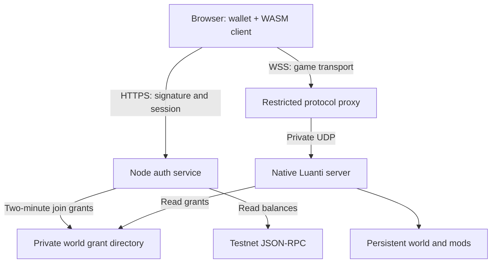

# Architecture and feasibility findings

Decision date: 2026-10-16; implementation updated 2026-10-22. Working name: MineMine. No claim of affiliation with Luanti.

## Reuse the engine

Luanti is the current name of Minetest. Compile an existing C++ port to WebAssembly rather than write an unrelated voxel renderer and call it Minetest. Keep mods and authoritative world simulation on a native server. Browser wallets remain in ordinary browser JavaScript.

Candidate: [paradust7/luanti-wasm](https://github.com/paradust7/luanti-wasm), formerly `minetest-wasm`. Its README describes an experimental Emscripten build, `build_all.sh`, `www/` output, required response headers, OPFS persistence, and network proxies. This is evidence of feasibility, not a verification of our build or a claim of production readiness.

Its [source fetch script](https://github.com/paradust7/luanti-wasm/blob/main/fetch_sources.sh) references dedicated engine and webshims forks and bundled versions including OpenSSL 1.1.1n, curl 7.82.0 and libarchive 3.6.1. These need review before public deployment. The parent wrapper commit could not be resolved locally. Observed nested hashes are recorded as research evidence, not a completed source lock.

Other ports surfaced during discovery, including Kaesual and ford442 variants. Their source/build behavior was not verified in this session. Reassess them if the selected candidate fails the compatibility, dependency or performance gate.

## Planned runtime topology

The solo WASM bundle has passed Chromium gameplay and persistence checks. The Node service, grant issuer, wallet UI, and experimental Lua mods are implemented. The pinned browser adapter and restricted proxy passed source/protocol tests and one real Chromium wallet character joined the native server in CI. The pinned engine originally printed its startup arguments, including the short-lived ticket, to the browser console; a prepared-source patch removed that dump and the rebuilt artifact passed the credential-safety browser test.

Browsers cannot open the native UDP sockets required by Luanti. The inspected pinned webshims client uses `NEWADDR`, `BIND`, and a 24-byte UDP envelope. The Node proxy implements those messages on same-origin WebSockets, checks a live wallet session and origin, caps connections, buffered bytes and ingress traffic, and forwards only to `127.0.0.1:GAME_PORT`. The browser targets fixed virtual address `10.0.0.1` because webshims keeps loopback packets in the browser; the proxy rejects TCP and every other UDP destination. A real WebSocket/UDP loopback test and one credential-safe browser-to-native join pass. Two-player interoperability and public multiplayer remain under CI validation. The [upstream sample proxy](https://github.com/paradust7/minetest-wasm-sample-proxy) informed protocol research, and the [ws server API](https://github.com/websockets/ws/blob/master/doc/ws.md) informed upgrade handling. Evaluate WebTransport only after a working WebSocket baseline and measured head-of-line blocking.

The available Sites host is a Cloudflare Workers environment and cannot run a long-lived native UDP game server. A Linux VM/container host is required for the world and matching proxy. A static frontend could later live on a CDN with compatible isolation headers, but a single-origin deployment is simplest initially.

## Identity boundary

1. Browser obtains an EOA address and the configured test-chain ID.
2. Server issues an exact [ERC-4361](https://eips.ethereum.org/EIPS/eip-4361) message with domain, URI, chain, nonce, issuance and expiry. An HttpOnly cookie binds the request to the browser.
3. Browser asks the wallet for `personal_sign`. Server recovers the signer using ethers, consumes the challenge, and establishes an opaque HttpOnly session.
4. Authenticated browser requests short-lived native-game credentials only when the engine adapter is explicitly enabled.
5. Player name is `w_` plus 17 hexadecimal characters of a SHA-256 wallet-address digest (19 total characters, within the pinned browser client's name limit). Full addresses are stored in grants and checked for mapping collisions.
6. After the WASM engine and game pack load, its same-origin frame requests a fresh ticket. The 256-bit random password is passed in memory through `LuantiArgs`; only the Luanti-compatible legacy hash is stored in the private world grant file. Grants expire after two minutes and are revoked on logout when owned by that session.
7. Lua custom authentication denies arbitrary registration and password changes. It grants only `interact` and `shout` by default.

The native legacy-hash authentication path passed one actual Chromium-to-native join after its base64 padding was corrected to Luanti's unpadded format. Registration rejection, privilege behavior and multiple players still require live-world checks. A grant is currently time-limited, not single-use. Connected gameplay can outlive the join grant. Logout closes its WebSocket bridge links, but native-game disconnect behavior must still be verified; those limitations are explicit A05/A06 gates.

EOA-only verification is intentional for this milestone. ERC-1271 contract wallets require chain-specific RPC validation. The browser session store is in memory: a restart logs users out and clears outstanding grants. Only one auth process may own the world directory. No distributed coordination is implied.

## Currency boundary

The [OpenZeppelin ERC-20](https://docs.openzeppelin.com/contracts/4.x/erc20) implementation provides token accounting. Prototype supply is minted once to a specified treasury. No game-server mint key exists. The launcher reads balances from the configured chain, returning decimal-safe strings and observation metadata.

Gameplay should remain off-chain. Mining events, inventory changes and movement must not trigger transactions. Future reward and purchase flows require authoritative server events, idempotent processing, finality/reorg policy and durable fulfillment records. A balance display alone is not a usable in-game economy.

## Hosting and performance

Serve WASM as `application/wasm`, with `Cross-Origin-Opener-Policy: same-origin` and `Cross-Origin-Embedder-Policy: require-corp` on applicable documents. Maintain secure context and same-origin worker resources. CSP permits only the exact same-origin WebSocket endpoint, not arbitrary proxy or script origins. The remote launcher runs in a same-origin iframe because the pinned runtime replaces its own document body.

Optimize measured world-rendering, map-loading and asset delivery bottlenecks. Record native-server and browser-client metrics separately. OPFS persistence in the upstream client is not a replacement for backups of the authoritative multiplayer world.
